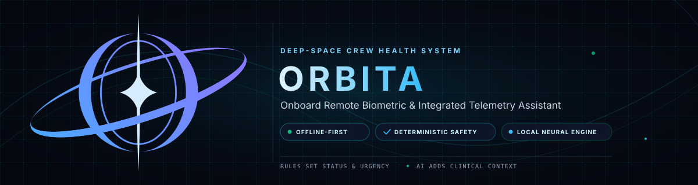

<p align="center">
  
</p>

<p align="center">
  
  
  
  
  
</p>

ORBITA is a desktop prototype by the CyberAstro team for the NASA Space Apps Challenge 2026.

## 1. Core Idea

Deep-space missions can face **more than 20 minutes of one-way communication delay**. That makes real-time consultation with Earth impractical when a crew member needs an immediate check-in.

ORBITA pairs an **offline-first deterministic clinical rules engine** with a local neural assistant. The rules engine assigns Green, Yellow, or Red status using configured thresholds and personal baselines, then sets the escalation path. The optional `granite3.3:8b` assistant runs through Ollama on the same device and explains the supplied context; it cannot assign or override a status or urgency level. The interface remains usable when Ollama is unavailable.

## 2. Key Capabilities

1. **Daily Biometric Check-up & Baseline Tracking** — Enter vital signs and radiation readings, switch between Metric and Imperial units, score mood and skin symptoms, and select symptom tags inline. Baseline comparisons include signed deviations, using the seven-day rolling window where configured by the rules.
2. **Onboard SI Assistant (Multi-Session Local AI)** — Keep separate saved conversations per crew profile, start with an immediate deterministic briefing, use context-aware prompt chips, and see an actionable `Next:` step for each triggered metric. Ollama is called only after a user request.
3. **Async Earth Mission Control & Telemetry Drawer** — Exchange persistent messages with a simulated Houston Flight Surgeon over a `~20 min` one-way link (`×60` demo acceleration). Attach a specific check-up snapshot and inspect its indicators, notes, and seven-day readings in a slide-over drawer.
4. **Crew Access Gate (NFC Demo Profiles)** — Switch between the demo profiles for Cmdr. Alex Vance, Dr. Maya Lin, and Flight Surgeon (Houston), each with isolated profile history. The gate also supports onboarding an unregistered badge.
5. **Zero-Cloud Privacy & Graceful Offline Fallback** — Check-up history and chat sessions are stored locally in profile-scoped `localStorage`. No cloud inference is required; if the local Ollama model is offline, ORBITA falls back to a deterministic local clinical summary.

## 3. Architecture & Tech Stack

```text
Check-up readings, symptom flags, and notes
                    │
                    ▼
             Input validation
                    │
                    ▼
     Profile history + personal baselines
                    │
                    ▼
       Deterministic rules engine
        (status, urgency, escalation)
          ┌─────────┴──────────┐
          ▼                    ▼
  Onboard SI context     Earth Mission Control
          │               telemetry snapshot
          ▼
  Ollama on localhost
  (explanation only)
```

| Layer | Technologies |
| --- | --- |
| Desktop application | Tauri v2, Rust |
| Frontend | React 19, TypeScript, Vite |
| Clinical logic | Local rules JSON, personal-baseline calculations |
| Local AI | Ollama with `granite3.3:8b` (optional) |
| UI and visualization | React, SVG, Recharts, Motion, lucide-react |
| Persistence and tests | Profile-scoped `localStorage`, Vitest |

### License

This repository is licensed under the **Apache License 2.0**. See [LICENSE](LICENSE).

## 4. Quick Start

### Prerequisites

- Node.js and npm
- Rust and Cargo for the Tauri desktop application
- Tauri's platform-specific development prerequisites (including WebView2 on Windows)
- Optional: [Ollama](https://ollama.com/) for local model responses

To enable the local neural assistant, install Ollama and pull the configured model:

```bash
ollama pull granite3.3:8b
```

From the repository root, install dependencies and start the desktop app:

```bash
npm install
npm run tauri dev
```

For frontend-only development, use `npm run dev`. Run checks with:

```bash
npx vitest run
npm run build
```

## 5. Project Structure

```text
.
├── public/
│   ├── favicon.svg
│   └── readme-banner.svg
├── src/
│   ├── components/          # Check-up, dashboard, Comms, and shared UI
│   ├── data/                # Rules, synthetic history, combinations, knowledge base
│   ├── features/
│   │   ├── ai-helper/       # Prompts, Ollama client, summaries, saved sessions
│   │   ├── app-state/       # Reactive check-up and evaluation state
│   │   ├── auth/            # Crew profiles, access gate, profile history
│   │   ├── earth-link/      # Async Earth chat and telemetry snapshots
│   │   ├── input-check/
│   │   ├── personal-baseline/
│   │   ├── radiation/
│   │   ├── storage/
│   │   └── synthetic-data/
│   ├── rules/               # Deterministic rules engine and domain types
│   ├── styles/              # Dark theme and layout styles
│   ├── App.tsx
│   └── main.tsx
├── src-tauri/
│   ├── icons/               # Native application icons
│   ├── src/                 # Rust application entry points
│   ├── Cargo.toml
│   ├── tauri.conf.json
│   └── build.rs
├── openspec/specs/          # Feature and rules-engine specifications
├── package.json
└── LICENSE
```

## 6. Links & Demo Video

**[▶ Watch Demo Video](#demo-video)** — the hosted video link will be added here when available.

### Demo Video

Demo video coming soon.

### Project Links

- [ORBITA repository](https://github.com/qpikzz/orbita)
- [Rules engine specification](openspec/specs/rules-engine.md)
- [Frontend architecture specification](openspec/specs/FRONTEND.md)
- [API contract](openspec/specs/API_CONTRACT.md)
- [Apache License 2.0](LICENSE)
